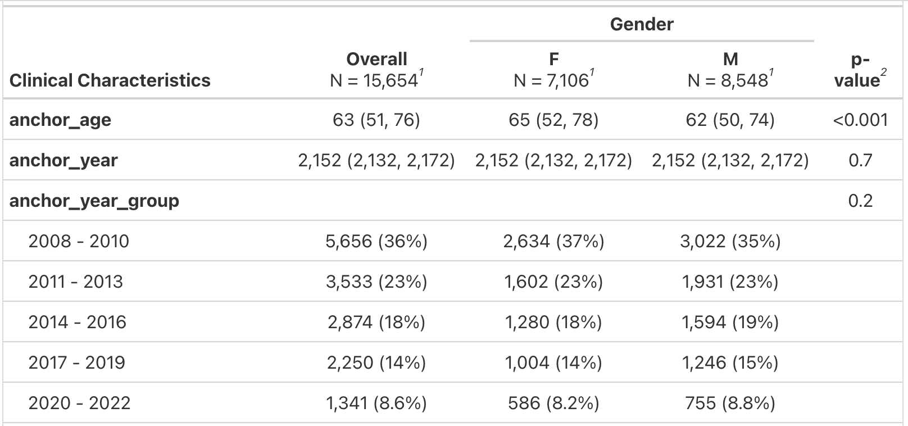
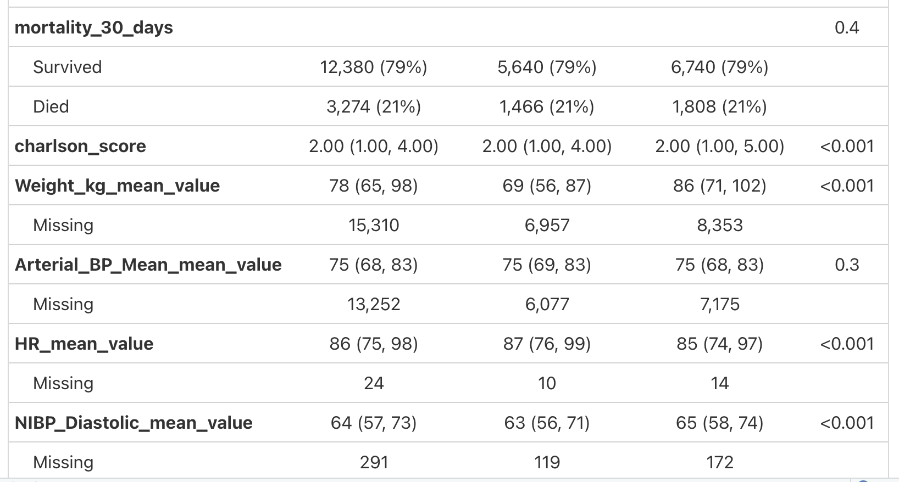
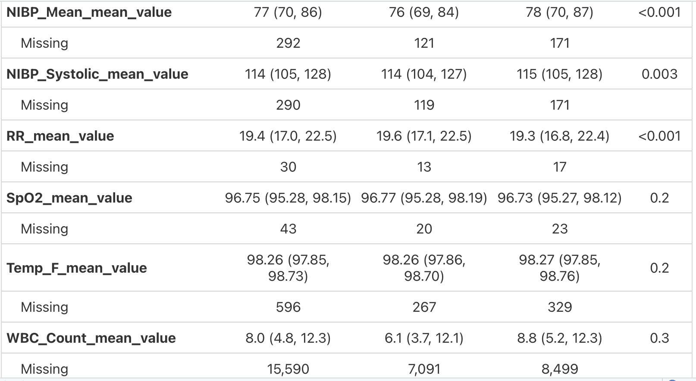
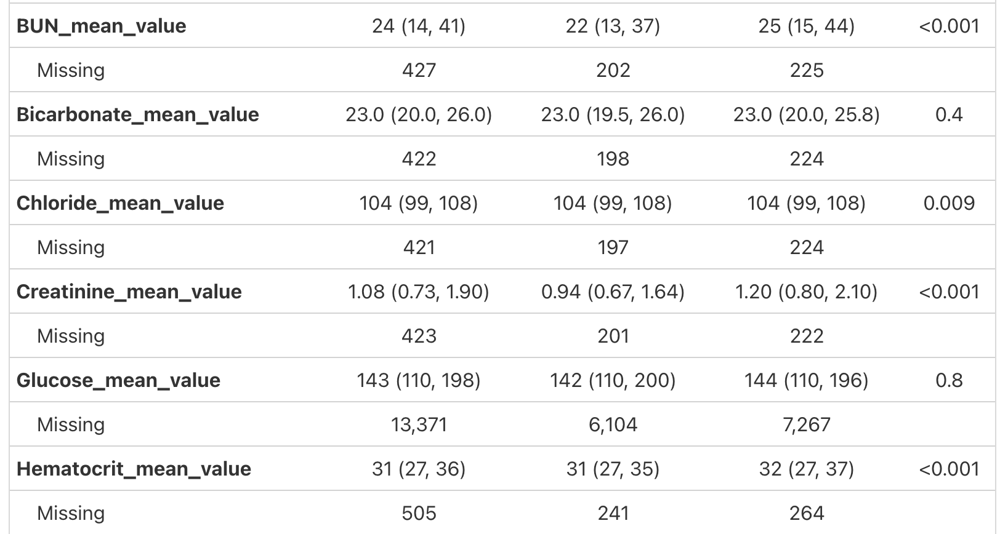
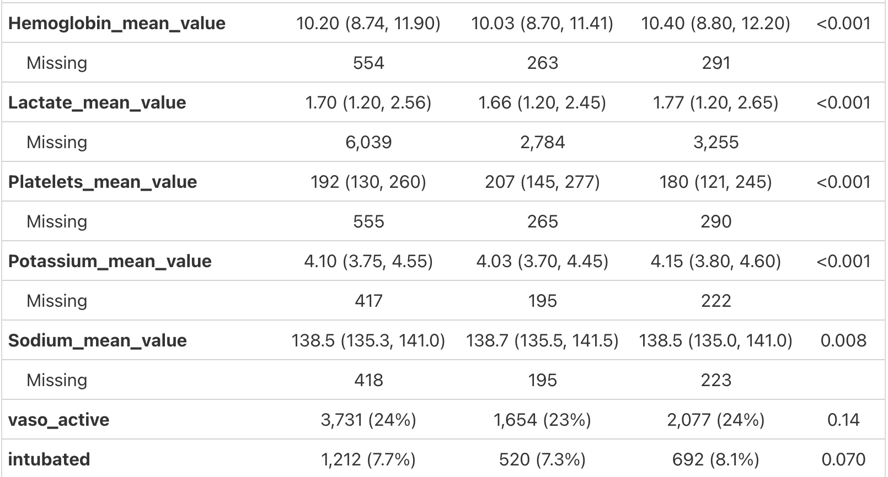
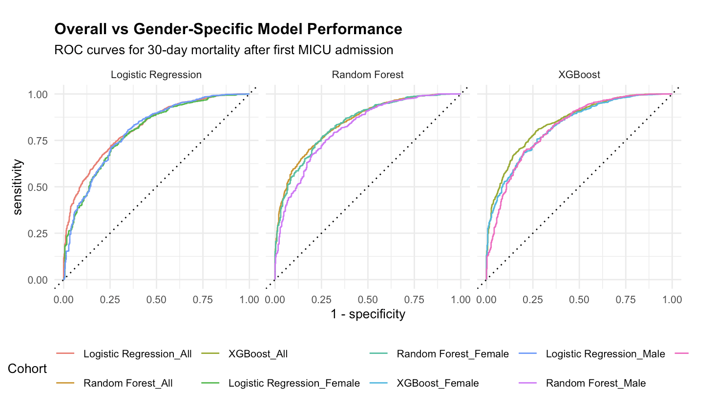
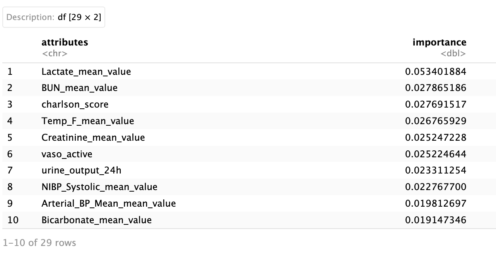

# Abstract

Provide a succinct summary of your entire project (~250–300 words), including:

Background - Context and why the problem matters

Objectives – What your project intends to investigate

Methods - Main approach and data sources

Results - Key findings

Conclusion - Implications and potential impact

# Introduction

## Background

### Topic Area Overview

Thirty-day all-cause mortality following admission to the Medical Intensive Care Unit (MICU) is an important outcome in critical care because it reflects both what happens during the ICU stay and what happens shortly after discharge. Even after leaving the ICU, many patients remain medically unstable and may still be at risk of death because of unresolved organ dysfunction, complications related to critical illness, or worsening of chronic disease. For that reason, short-term mortality after MICU admission is often used as a quality and outcomes metric in critical care research.

Large critical care databases such as MIMIC-IV make it possible to study these outcomes using detailed clinical information collected during ICU admission. Because the database includes physiologic measurements, laboratory values, diagnoses, and treatment information, it provides a strong foundation for building prediction models that identify which early ICU features are most associated with mortality within 30 days of admission.

An important part of ICU outcomes research is understanding the role of biological sex and gender in influencing critical illness trajectories and mortality risk. Prior studies suggest that male and female patients may differ in baseline comorbidity burden, physiologic response to severe illness, treatment patterns, and recovery after critical care. These differences may affect both short-term survival and which predictors are most important in mortality models. By evaluating mortality separately in male and female MICU cohorts, this project examines whether early clinical predictors behave similarly across groups or whether gender-specific patterns emerge. Using the clinical data available in MIMIC-IV, this analysis compares pooled and gender-specific machine learning models to better understand early predictors of 30-day mortality after MICU admission.

### Impact Statement

Understanding which patients are at highest risk of early death after MICU hospitalization is important because it can directly affect how clinicians plan care after ICU admission and discharge. If high-risk patients can be identified early, providers may be able to adjust monitoring, improve discharge planning, or intervene sooner when signs of deterioration appear. In a broader sense, prediction models built from large clinical datasets such as MIMIC-IV can support decision-making by showing which early physiologic and laboratory features are most strongly associated with short-term mortality. This type of information could eventually help guide how resources are allocated and how prognosis is discussed with patients and families.

Studying whether these predictors differ by gender is also important because male and female patients may experience critical illness differently. Prior research suggests that sex-related differences in immune response, cardiovascular physiology, and comorbidity burden may influence survival after severe illness. At the same time, differences in treatment patterns or access to care may also contribute to variation in outcomes. By comparing mortality predictors across male and female MICU cohorts, this project examines whether the same clinical variables perform similarly across groups or whether separate models may better capture risk. Identifying these differences may support more individualized approaches to ICU outcome prediction and improve how mortality risk is interpreted across patient populations.

## Literature Review

### Hollinger et al. (2019) — Gender and survival of critically ill patients: results from the FROG-ICU study
This multicenter ICU study examined longer-term survival after critical illness, including one-year mortality, and compared outcomes by gender. After adjustment for illness severity and other clinical factors, the authors did not find major sex-based differences in long-term mortality, suggesting that gender alone may not explain survival differences without considering additional clinical context.

### Johnson et al. (2023) — MIMIC-IV, a freely accessible electronic health record dataset
This paper provides the main description of the MIMIC-IV database used in this project. It explains how MIMIC-IV contains detailed ICU information such as vital signs, laboratory values, diagnoses, procedures, medications, and longitudinal hospital records, making it a strong resource for clinical prediction modeling.

### Kohn et al. (2023) — Prediction of in-hospital mortality among intensive care unit patients using modified daily Laboratory-based Acute Physiology Scores (LAPS2)
This study examined mortality prediction using repeated daily physiologic updates rather than only admission variables. The authors showed that time-updated laboratory information improved both model discrimination and calibration. Although the endpoint was similar to short-term mortality, the analysis was not designed around gender-specific prediction.

### Lat et al. (2021) — Gender Differences in Critical Illness and Critical Care Research
This review summarizes current evidence on sex differences in critical care outcomes and notes that prior findings are often inconsistent. It highlights possible differences in immune response, delirium, ARDS, and treatment patterns between men and women, which supports exploring gender-specific predictors in ICU datasets.

### Luo et al. (2017) — Interpretable topic features for post-ICU mortality prediction
This study evaluated 30-day post-discharge mortality prediction and found that combining diagnosis hierarchies with clinical text improved predictive performance, with AUC values near 0.83. However, the analysis focused on selected high-risk ICU patients and did not specifically examine whether predictors differed by gender.

### Mahmood et al. (2012) — Association of gender with outcomes in critically ill patients
This is one of the larger studies examining sex differences in ICU outcomes. The authors reported that women under age 50 had lower ICU mortality than men, but this difference became less apparent in older age groups. Their primary focus was ICU mortality rather than mortality within 30 days after MICU admission.

### Merdji et al. (2023) — Sex and gender differences in intensive care medicine
This review discusses how reported sex differences in ICU outcomes often depend on the mortality timepoint studied, the severity score selected, and study design. It emphasizes that sex-related findings in critical care remain sensitive to methodology, which supports further subgroup modeling.

### Pang et al. (2022) — Establishment of ICU Mortality Risk Prediction Models with Machine Learning Algorithm Using MIMIC-IV Database
This paper is closely related to the current project because it used MIMIC-IV data to compare several machine learning approaches for ICU mortality prediction. The authors reported strong predictive performance, with XGBoost achieving AUC values above 0.90, supporting the use of ensemble methods for ICU risk prediction.

### van Vught et al. (2017) — Association of Gender With Outcome and Host Response in Critically Ill Sepsis Patients
This study focused on patients with sepsis and examined sex-related differences in host inflammatory response and survival. Because sepsis is a major contributor to ICU mortality, the paper is useful for understanding biologic mechanisms that may partly explain mortality differences between men and women.

### Vasilevskis et al. (2011) — Predictors of early postdischarge mortality in critically ill patients: a retrospective cohort study from the California Intensive Care Outcomes project
This study is highly relevant because it examined mortality shortly after ICU discharge. The authors found that severity of illness, discharge location, code status, and shorter ICU stay were associated with early mortality, although the work predates newer electronic health record-based machine learning methods.

## Problem Statement

Although outcomes in critical care have advanced, 30-day all-cause mortality after MICU hospitalization is still clinically important because many patients remain unstable during the early recovery period. Most current prediction models focus on ICU mortality or hospital mortality and do not specifically evaluate short-term mortality after MICU admission. In many studies, sex is treated only as a control variable, so it remains unclear whether the main predictors of mortality are the same for male and female patients. Understanding of whether the predictors of 30-day post-MICU mortality differ by sex/gender is limited, and important to investigate because it may support more individualized risk prediction and inform how clinicians interpret mortality risk across patient populations.

## Objectives

Using the detailed patient-level data available in MIMIC-IV, this project investigates predictors of 30-day all-cause mortality after MICU admission and develops separate prediction models for male and female patients. The main goal is to determine whether important mortality predictors differ by gender and whether short-term mortality rates vary between the two groups.

## Project Aims/Hypotheses

The main objective of this study is to identify clinical, physiologic, and laboratory factors associated with 30-day all-cause mortality after a first MICU admission. Using MIMIC-IV data, I built separate mortality prediction models for male and female patients to evaluate whether the strongest predictors of early mortality differ by gender. I also aim to compare overall 30-day mortality rates between male and female MICU patients to assess whether there is a disparity in short-term mortality between the two groups.

I expect that the strongest predictors of 30-day mortality will not be identical between male and female MICU patients, reflecting possible biologic, physiologic, or clinical differences during critical illness. I also expect that separate gender-specific models may improve interpretation of which variables are most strongly associated with short-term mortality compared with a single pooled model. Overall, this project aims to evaluate whether gender-specific modeling offers additional insight into mortality risk after MICU admission.

# Methods

## Data Source or Materials

### Dataset Used:
MIMIC-IV (Medical Information Mart for Intensive Care, version IV) is a large, freely accessible database containing de-identified electronic health data associated with over 70,000 ICU admissions at Beth Israel Deaconess Medical Center between 2008 and 2019. The database includes patient demographics, ICU stay information, laboratory measurements, bedside vital signs, diagnoses, and procedures collected during routine clinical care.

### Inclusion/Exclusion Criteria:
The analytic cohort included adult patients aged 18 years or older whose first ICU stay occurred in the Medical Intensive Care Unit (MICU). Only the first MICU admission per patient was retained by selecting the earliest ICU admission time for each subject, which allowed for avoidance of duplicate patients or patients with risk factors from previous ICU admissions. Patients were excluded if key demographic variables necessary for stratified analysis, specifically age or sex, were missing, because these variables were required for subgroup analysis. The final cohort contained 15,654 patients, including 7,106 female patients and 8,548 male patients, among whom 3,274 deaths occurred within 30 days of ICU admission.

### Strategies for handling big data:
Data extraction and cohort construction were performed using Google BigQuery through the R packages bigrquery and DBI. Large tables were queried directly in the cloud using dbplyr-style pipelines, and only required variables were collected locally after filtering. Intermediate processed datasets were saved as .rds files to reduce repeated query cost and improve reproducibility.

### Privacy and Appropriate Use and MIMIC Credentialing Context
All analyses were conducted using de-identified patient data under the MIMIC data use agreement. Database access required credentialing through PhysioNet, including completion of the Collaborative Institutional Training Initiative (CITI) course on “Data or Specimens Only Research" ethics training. Access to the database required credentialing through PhysioNet The MIMIC-IV dataset is de-identified according to HIPAA Safe Harbor standards, and therefore studies using the database typically qualify as non-human subjects research. We have adhered to all data use policies, including prohibitions on re-identification attempts and requirements for secure data handling during analysis.

## Variables / Features

### Which Variables Were Included and Why:
The analysis included demographic, comorbidity, physiologic, laboratory, and early intervention variables selected based on both clinical relevance and availability during the first 24 hours of MICU admission. Demographic variables included age and gender, which were retained because they are directly related to baseline patient characteristics and were necessary for the gender-stratified analysis. Comorbidity burden was summarized using the Charlson Comorbidity Index, derived from ICD-9 and ICD-10 diagnosis codes. Early physiologic indicators included first 24-hour mean values of heart rate, respiratory rate, oxygen saturation, temperature, arterial mean blood pressure, non-invasive systolic blood pressure, non-invasive diastolic blood pressure, non-invasive mean blood pressure, and admission weight. Laboratory variables included first 24-hour mean values of lactate, creatinine, white blood cell count, glucose, sodium, potassium, chloride, bicarbonate, blood urea nitrogen, hemoglobin, hematocrit, and platelet count. Additional clinical intervention variables included vasopressor use, intubation status, and total urine output during the first 24 hours after MICU admission. These variables were selected because they are clinically interpretable, routinely collected early during ICU admission, and likely to contribute to short-term mortality prediction.

### How Variables were Processed or Transformed:
For vital signs and laboratory values, all measurements recorded during the first 24 hours after MICU admission were averaged by patient stay. Charlson scores were derived from ICD-9 and ICD-10 diagnosis codes using the comorbidity package.

Missing numeric variables were imputed using median imputation, while categorical variables were imputed using mode imputation. Predictors were normalized after preprocessing, and categorical variables were converted to dummy variables where required.

Feature selection was performed using mutual information scores calculated on the imputed training dataset. Only predictors with positive information gain were retained for model fitting.

## Analytical Approach / Modeling

### Index time, prediction window, and outcome definition:
Index time was defined as the start of the first MICU admission. This approach aligns with real-world clinical decision-making, where clinicians must assess patient risk based on when they show up in the ICU. 

The primary outcome was 30-day all-cause mortality, defined by whether recorded date of death occurred within 30 days of ICU admission.

The prediction window started at MICU admission and extended through the next 30 days, allowing the outcome to capture deaths that occurred both during hospitalization and in the early period after discharge.
Days to death were calculated by comparing ICU admission time with recorded death date. Patients were classified as 'Survived' if death did not occur within 30 days and 'Died' if death occurred within 30 days. 

### Machine learning algorithms:
Three machine learning approaches were used to predict 30-day mortality after MICU admission. Penalized logistic regression was included as a baseline model because it is relatively interpretable and allows direct comparison with more flexible methods. Random forest was used to account for possible nonlinear relationships and interactions across predictors. Finallly, XGBoost was included as a boosting-based ensemble method designed to improve predictive performance when feature relationships are more complex. These three models were chosen to compare a traditional regression approach with two machine learning methods that can capture more complicated patterns in the data.

### Software used (e.g., R packages):
All analyses were performed in R using packages for database access, preprocessing, modeling, and visualization. Data were queried directly from the cloud-based MIMIC-IV database using the bigrquery and DBI packages, and most data cleaning and feature construction were carried out with tidyverse functions. Model development was done using the tidymodels framework, which was used to define preprocessing recipes, tune hyperparameters, and fit prediction models. Within this framework, glmnet was used for penalized logistic regression, ranger for random forest, and xgboost for gradient boosting. ROC curves and ROC-AUC values were calculated using yardstick, while figures were generated with ggplot2. A Shiny application was also developed to allow interactive exploration of cohort variables, patient timelines, and model prediction results.

## Model Evaluation

### Performance metrics (e.g., ROC/AUC, accuracy)
Model performance was evaluated using classification metrics appropriate for predicting 30-day mortality in a clinical dataset with an imbalanced outcome distribution. The main performance measure was the area under the receiver operating characteristic curve (ROC-AUC), which reflects how well each model distinguished between patients who died within 30 days and those who survived. Classification accuracy was also recorded for each model during tuning and final evaluation. ROC curves were generated to visually compare discrimination across models in the full cohort and in the gender-specific analyses. In the Shiny application, an adjustable probability threshold was also used to examine clinical alert performance by summarizing true positives, false positives, false negatives, and sensitivity at different cutoff values.

### Validation methods:
Model validation used both a train–test split and cross-validation so that model performance could be evaluated on data not used during training. The full dataset was split into 80% training data and 20% testing data using stratified sampling based on 30-day mortality status, so that the outcome distribution remained similar across both sets. The training data were used for preprocessing, feature selection, and model tuning, while the test set was reserved for final model evaluation. Within the training set, 5-fold cross-validation was used during hyperparameter tuning to reduce overfitting and compare candidate model settings.

# Results

State your findings clearly and objectively. Provide tables and figures where appropriate.

## Cohort / Sample Characteristics

The final analytic cohort included 15,654 adult patients with a first MICU admission in MIMIC-IV after applying inclusion and exclusion criteria. Of these patients, 7,106 were female and 8,548 were male. Thirty-day mortality occurred in 20.6% of female patients and 21.2% of male patients, indicating a very slightly higher observed mortality rate in the male subgroup. Baseline cohort characteristics are summarized in Table 1, stratified by gender.

The cohort included demographic information, Charlson comorbidity scores, first 24-hour vital sign averages, laboratory measurements, and early intervention variables such as vasopressor use, intubation status, and urine output. Median values and interquartile ranges were reported for continuous variables, while categorical variables were summarized as counts and percentages. Overall, the two gender groups were similar in size and shared many clinical features, although several physiologic and laboratory variables showed statistically significant differences between groups in the descriptive summary table.

{width=90%}

{width=90%}

{width=90%}

{width=90%}

{width=90%}

{width=90%}

## Model Performance
Model performance was compared across penalized logistic regression, random forest, and XGBoost using ROC-AUC and classification accuracy on the held-out test set. Across the full cohort, all three models showed reasonable discrimination for predicting 30-day mortality, with differences in ROC-AUC remaining relatively modest across algorithms. XGBoost generally produced the strongest discrimination among the three approaches, while penalized logistic regression provided a more interpretable baseline model.

When models were fit separately by gender, overall performance remained similar to the pooled analysis, although some differences in ROC shape and feature ranking were observed between the male and female subgroups. This suggests that while overall predictive ability was comparable, the relative contribution of individual predictors may differ by gender. ROC curves comparing pooled and gender-specific models are shown in Figure 1.

{width=80%}

## Additional Analyses
Additional analysis focused on ranking predictors using mutual information scores calculated from the imputed training data. Mutual information was used to estimate how much each feature reduced uncertainty about 30-day mortality before model fitting. The highest-ranked predictors included lactate, blood urea nitrogen, Charlson comorbidity score, temperature, creatinine, vasopressor exposure, and urine output, which are all clinically relevant markers of illness severity and organ dysfunction. These rankings were used to guide feature selection before fitting the final models and to compare predictor importance across subgroup analyses.

{width=80%}

# Discussion
Overall, the models showed that early clinical and laboratory information collected during MICU admission can provide meaningful prediction of 30-day mortality risk. Across the three modeling approaches, performance differences were present but relatively modest, with XGBoost generally showing the strongest discrimination while penalized logistic regression remained useful as a more interpretable baseline. This suggests that more flexible machine learning methods may capture nonlinear relationships in ICU data, but simpler models still retain value when interpretability is important.

The feature ranking results were also clinically consistent. Variables such as lactate, blood urea nitrogen, creatinine, vasopressor exposure, and urine output ranked highly, which aligns with established markers of hemodynamic instability, renal dysfunction, and overall illness severity in critically ill patients. These findings suggest that the variables most strongly associated with short-term mortality in this cohort are also those commonly used in bedside ICU assessment.

When comparing pooled and gender-specific models, overall ROC performance remained similar, although some differences in predictor ranking and ROC shape were observed between male and female cohorts. This may indicate that while overall discrimination is comparable, the relative contribution of specific predictors may differ across groups. Because the subgroup sample sizes were smaller after stratification, these differences should be interpreted cautiously.

## Summary of Findings
The main goal of this project was to evaluate whether early MICU clinical data could be used to predict 30-day all-cause mortality and whether prediction patterns differed when models were fit separately by gender. Overall, the results showed that all three machine learning approaches were able to distinguish between patients who survived and patients who died within 30 days with reasonable performance on the held-out test data. XGBoost generally produced the strongest ROC performance, while penalized logistic regression provided a useful baseline because of its interpretability.

The feature ranking analysis also showed that several of the highest-ranked predictors were clinically consistent with known markers of severe illness, including lactate, blood urea nitrogen, creatinine, vasopressor exposure, and urine output. These findings support the original aim of identifying early physiologic and laboratory variables associated with short-term mortality risk after MICU admission.

When comparing pooled and gender-specific models, overall predictive performance remained relatively similar, although some variation in predictor importance was observed between male and female subgroups. This suggests that while mortality prediction was possible across all groups, some clinical features may contribute differently depending on subgroup composition.

## Comparison with Previous Work
The findings from this project are generally consistent with prior ICU mortality studies showing that early physiologic and laboratory measurements are strong predictors of short-term mortality. Similar to previous work using MIMIC-IV, machine learning models in this analysis showed reasonable discrimination for mortality prediction, with XGBoost performing slightly better than the other approaches. This aligns with studies such as Pang et al., which also reported strong predictive performance from gradient boosting methods in ICU outcome prediction.

The feature importance results were also consistent with earlier literature emphasizing markers of organ dysfunction and acute physiologic instability. Variables such as lactate, creatinine, and blood urea nitrogen have been repeatedly associated with worse ICU outcomes and appeared among the highest-ranked predictors in this analysis as well.

In contrast to many earlier studies that included sex only as a single adjustment variable, this project also examined separate gender-specific models. Although overall ROC performance remained similar between pooled and subgroup analyses, some differences in predictor ranking were observed, which supports prior literature suggesting that sex-related differences may influence critical illness trajectories even when overall mortality rates are similar.

## Strengths and Limitations
One strength of this project is that it used a large, well-characterized ICU dataset with detailed physiologic, laboratory, and intervention variables available early in admission. Using BigQuery allowed efficient extraction of high-volume MIMIC-IV data without needing to download large raw tables locally, and the preprocessing pipeline was applied consistently across both pooled and gender-specific analyses. Comparing three different machine learning models also made it possible to evaluate whether more flexible algorithms improved prediction beyond a simpler baseline approach.

Another strength is that the predictors included variables that are clinically interpretable and available early enough to support short-term risk assessment. The feature ranking results were also consistent with variables already recognized in ICU care, which supports the clinical plausibility of the findings.

Several limitations should also be considered. First, this analysis relied only on variables available early in the ICU stay and did not incorporate time-updating measurements, medication dose intensity, or diagnosis history beyond the selected comorbidity summary. Second, because the data come from a single medical center represented in MIMIC-IV, the findings may not generalize directly to other hospitals or ICU populations. Third, after splitting by gender, subgroup sample sizes became smaller, which may limit stability of the gender-specific models and make small differences harder to interpret confidently. Finally, although machine learning models showed useful discrimination, these models were developed for comparison rather than prospective clinical deployment and would require additional external validation before practical use.

## Implications
These findings suggest that early MICU data available within the first 24 hours of admission can be used to identify patients at increased risk of short-term mortality using relatively accessible machine learning methods. Because many of the strongest predictors were routine laboratory values, vital signs, and early intervention markers, similar approaches could potentially support clinical risk stratification without requiring highly specialized data inputs.

From a practical standpoint, models like these could help clinicians identify patients who may benefit from closer monitoring, earlier follow-up planning, or additional discharge support after critical illness. Although the current models are not intended for direct bedside implementation, they demonstrate how routinely collected ICU data can be organized into prediction frameworks that may eventually support clinical decision-making.

The subgroup analyses also suggest that examining prediction patterns within different patient groups may provide additional insight beyond a single pooled model. Even when overall model performance was similar, differences in feature ranking indicate that some predictors may contribute differently across subgroups, which could be relevant for future personalized risk prediction research.

## Conclusion
This project showed that early clinical information collected during MICU admission can be used to predict 30-day all-cause mortality with reasonable accuracy across several machine learning approaches. Among the three models evaluated, XGBoost generally produced the strongest discrimination, while logistic regression remained useful as a more interpretable baseline. Important predictors identified through feature ranking included markers of organ dysfunction and acute physiologic instability, such as lactate, creatinine, blood urea nitrogen, vasopressor use, and urine output.

A key contribution of this project was comparing pooled and gender-specific prediction models using the same preprocessing and evaluation framework. Although overall predictive performance remained similar across groups, some differences in feature importance suggest that subgroup analyses may provide additional clinical insight beyond a single combined model.

Future work could expand this analysis by incorporating time-updating measurements, additional treatment variables, and external validation in other ICU datasets. Further investigation of subgroup-specific prediction strategies may also help determine whether more personalized ICU mortality prediction models improve clinical usefulness.

# References

1. Hollinger, A., Wittebole, X., François, B., Pickkers, P., Antonelli, M., Gayat, E., Chousterman, B. G., Lascarrou, J. B., Dugernier, T., Di Somma, S., & Mebazaa, A. (2019). Gender and survival of critically ill patients: Results from the FROG-ICU study. Annals of Intensive Care, 9(1), 43. https://doi.org/10.1186/s13613-019-0514-9
 
2. Johnson, A. E. W., Pollard, T. J., Shen, L., Lehman, L. W. H., Feng, M., Ghassemi, M., Moody, B., Szolovits, P., Celi, L. A., & Mark, R. G. (2023). MIMIC-IV, a freely accessible electronic health record dataset. Scientific Data, 10, 1–10. https://doi.org/10.1038/s41597-022-01899-x
 
3. Kohn, R., et al. (2023). Prediction of in-hospital mortality among intensive care unit patients using modified daily Laboratory-based Acute Physiology Scores, version 2 (LAPS2). Critical Care Medicine, 51(7), 1–10. https://doi.org/10.1097/CCM.0000000000005925
 
4. Lat, I., Paciullo, C., Daley, M. J., & Valcin, M. (2021). Gender differences in critical illness and critical care research. Journal of Intensive Care Medicine, 36(9), 1039–1047. https://doi.org/10.1177/0885066620957593
 
5. Luo, Y., Xin, Y., Joshi, R., Celi, L. A., & Szolovits, P. (2017). Predicting ICU mortality risk by grouping temporal trends from a multivariate panel of physiologic measurements. Proceedings of the AAAI Conference on Artificial Intelligence, 31(1), 42–50.
 
6. Mahmood, S. S., Pinsky, M. R., & Donnelly, J. P. (2012). The association of gender with outcomes in critically ill patients. Critical Care Medicine, 40(5), 1616–1623. https://doi.org/10.1097/CCM.0b013e318241eaf7
 
7. Merdji, H., Mayaux, J., Schenck, M., & Demoule, A. (2023). Sex and gender differences in intensive care medicine. Annals of Intensive Care, 13, 78. https://doi.org/10.1186/s13613-023-01168-6
 
8. Pang, M., Feng, J., Wang, Y., & Wang, W. (2022). Establishment of ICU mortality risk prediction models with machine learning algorithm using MIMIC-IV database. BMC Medical Informatics and Decision Making, 22, 1–13. https://doi.org/10.1186/s12911-022-01865-4
 
9. van Vught, L. A., Wiewel, M. A., Klein Klouwenberg, P. M., Hoogendijk, A. J., Scicluna, B. P., Ong, D. S. Y., Cremer, O. L., Horn, J., Schultz, M. J., van der Poll, T., & Bonten, M. J. M. (2017). Association of gender with outcome and host response in critically ill sepsis patients. Critical Care Medicine, 45(11), 1854–1862. https://doi.org/10.1097/CCM.0000000000002650
 
10. Vasilevskis, E. E., Chandrasekhar, R., Holtze, C., Graves, J., & Ely, E. W. (2011). Predictors of early postdischarge mortality in critically ill patients: A retrospective cohort study from the California Intensive Care Outcomes project. Critical Care Medicine, 39(12), 1–8. https://doi.org/10.1097/CCM.0b013e3182282a11

# AI usage acknowledgement
Artificial intelligence tools were used during portions of the coding workflow for this project. ChatGPT and GitHub Copilot were used to help troubleshoot errors, suggest code structure in R, and provide examples for data processing, machine learning implementation, and Shiny app development. All suggested code was reviewed, adapted to match the project goals, and tested before inclusion in the final analysis.
